# Robust Machine Learning Integration Computation Process for Manufacturing (Python Code Implementation)

Research on Robust Machine Learning Integration Computation Process for Manufacturing (Python Code Implementation)
Run Result:
\n        \n  
\n        \n  
\n        \n  
\n        \n  
\n        \n  
\n        \n  
\n        \n  
\n        \n  
\n        \n  
\n        \n  
\n        \n  
\n        \n  

## Images

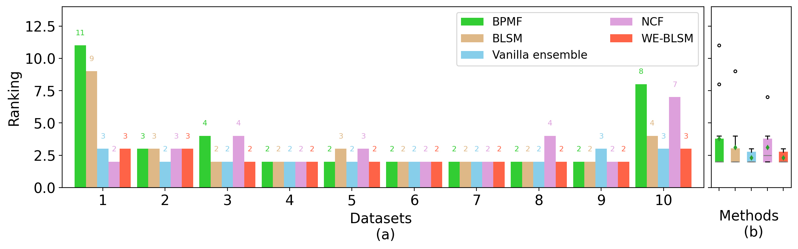
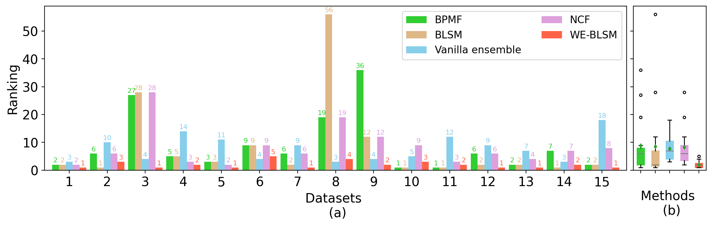
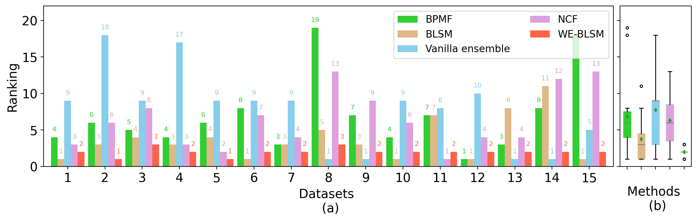
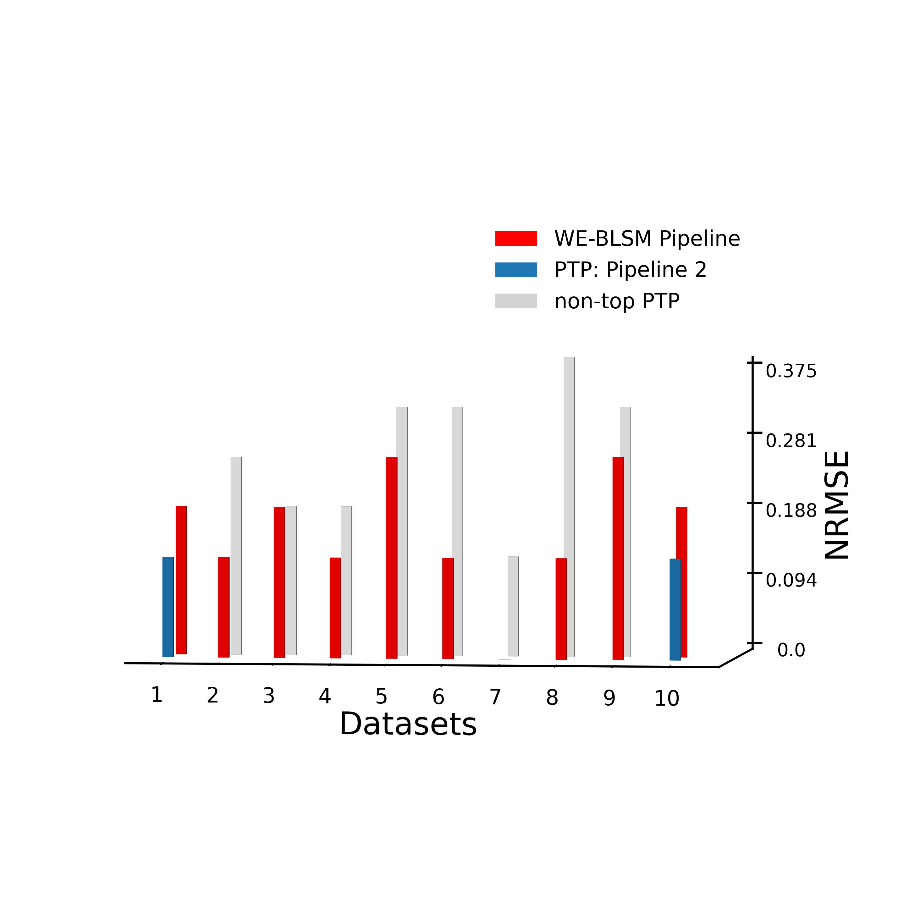
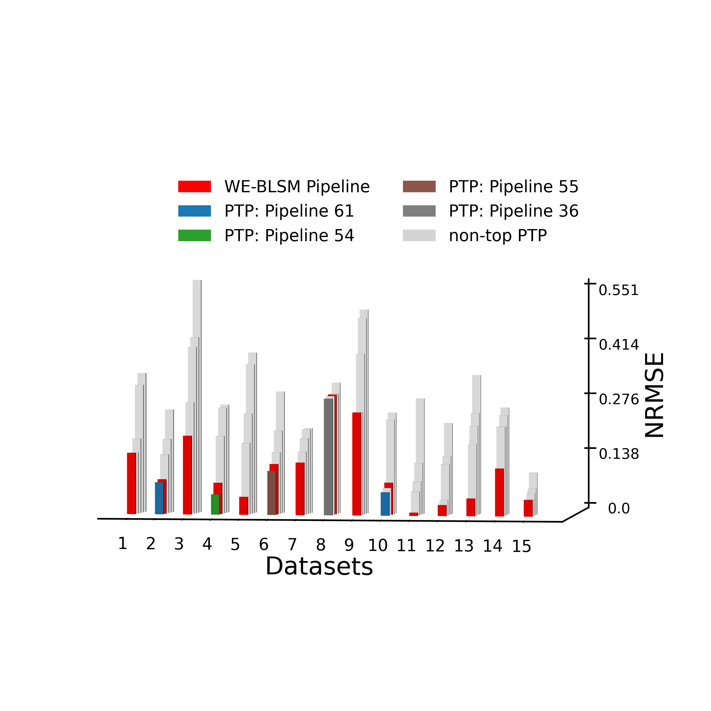
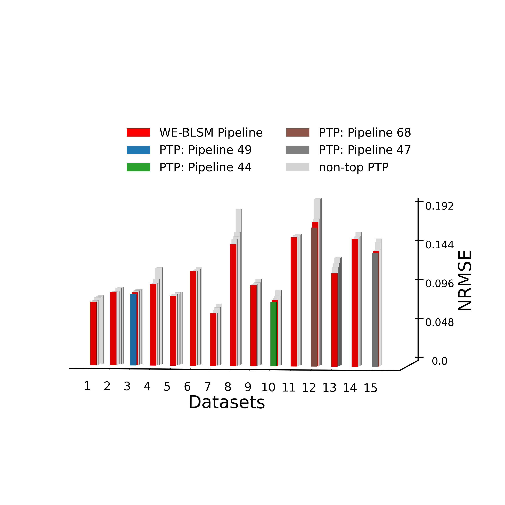
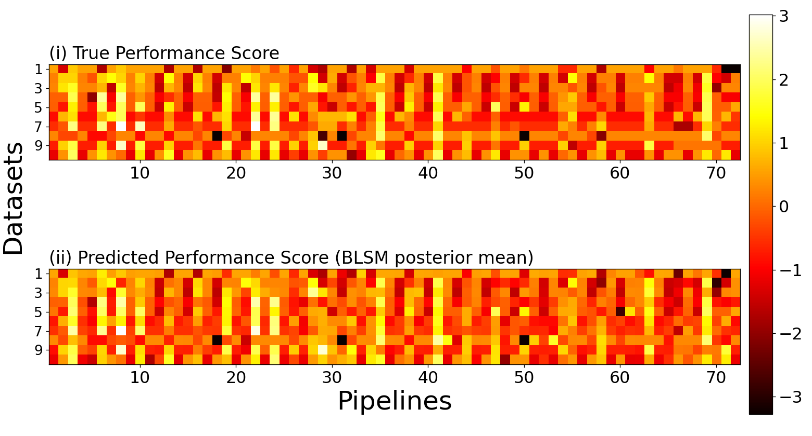
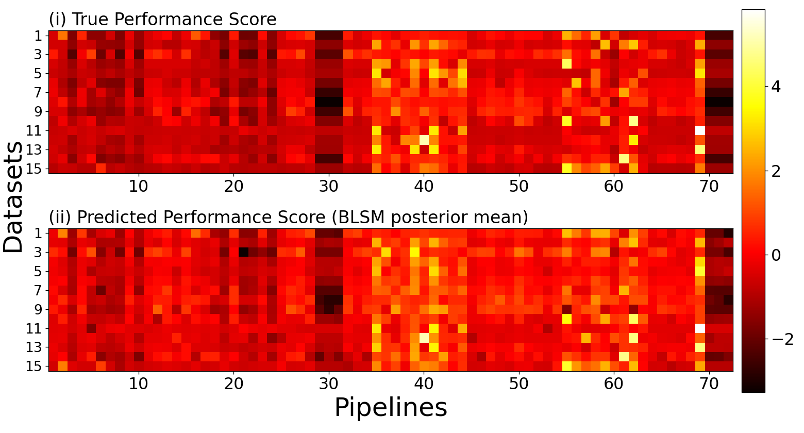
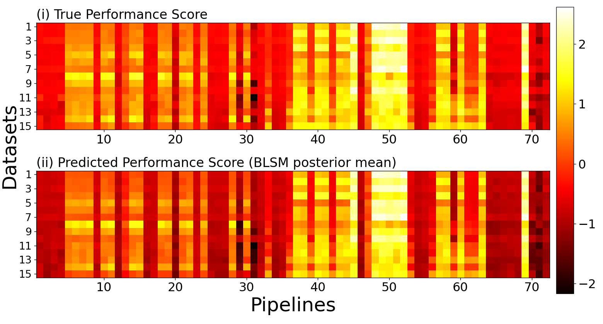
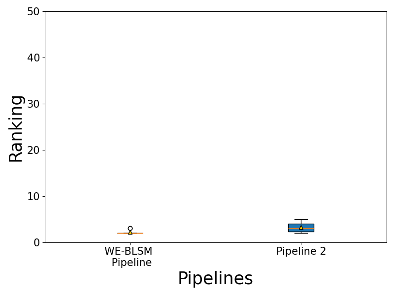
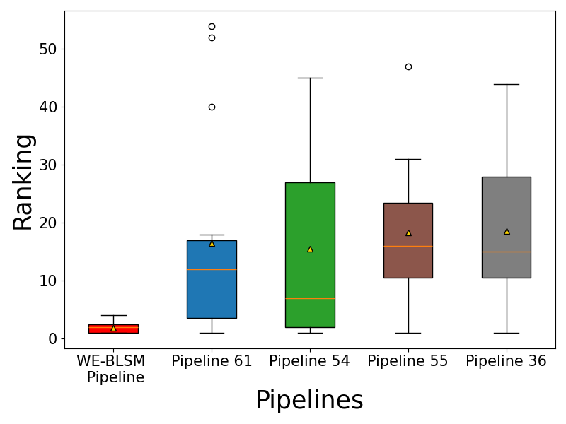
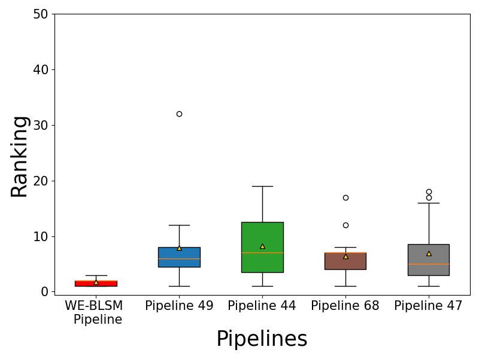

<!-- PAYMENT_BLOCK -->

## Get this dataset

- Payment link (Stripe): [Buy now](https://buy.stripe.com/3cs8yP7sY87d0vu9AB)
- Payment QR code: 

<!-- /PAYMENT_BLOCK -->
